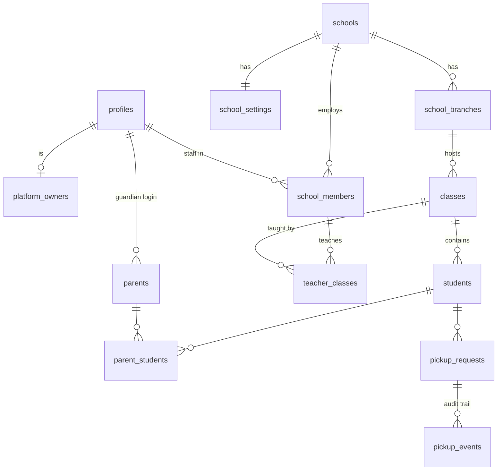
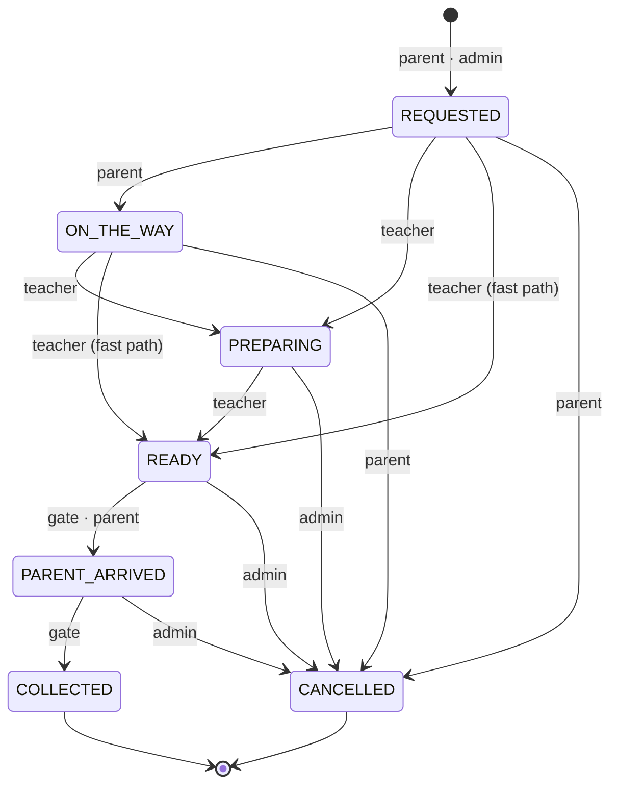

# Pickly — Architecture

Pickly is a multi-tenant SaaS for school dismissal. Parents request a pickup, teachers prepare the student, gate staff hand the student over, and everyone sees the same status live.

This document covers:

1. Project architecture
2. Database schema
3. Authorization and the RLS model
4. Routes and pages
5. Components and the design system
6. Security risks and mitigations

The delivery plan is in [MILESTONES.md](./MILESTONES.md).

---

## 1. Project architecture

```
┌────────────────────────── Browser (phone / tablet / desktop) ──────────────────────────┐
│  Next.js client components                                                            │
│   • Supabase browser client: auth session + Realtime subscriptions (RLS-filtered)     │
└───────────────▲──────────────────────────────────────────────────────▲────────────────┘
                │ HTML / RSC / Server Actions                           │ WebSocket (Realtime)
┌───────────────┴───────────── Next.js 16 (App Router, Node) ───────────┼────────────────┐
│  src/proxy.ts           locale routing, session refresh, optimistic auth redirects     │
│  Server Components      read data as the signed-in user (RLS applies)                  │
│  Server Actions         sign-in/out; later admin mutations and pickup RPC calls        │
│  lib/auth/session.ts    Data Access Layer for identity: roles, schools, workspaces     │
└───────────────┬────────────────────────────────────────────────────────────────────────┘
                │ PostgREST (JWT of the user)                          │
┌───────────────▼────────────────────────── Supabase ──────────────────▼────────────────┐
│  Auth (GoTrue)  ·  PostgREST  ·  Realtime (postgres_changes)  ·  Postgres 17           │
│  Postgres is the security boundary:                                                    │
│   • RLS on every table   • private.* authorization helpers                             │
│   • request_pickup / transition_pickup: the only write path for pickups                │
│   • immutable pickup_events audit trail                                                │
└────────────────────────────────────────────────────────────────────────────────────────┘
```

### Principles

- **The database enforces security.** Every rule that matters, including tenant isolation, role permissions, valid transitions and the audit trail, is enforced in Postgres. The UI only decides what to show. A bug in a React component cannot leak another school's data.
- **One write path for pickups.** Clients never `INSERT` or `UPDATE` pickup tables. They call two RPC functions. Each call authorizes the caller, validates the transition, locks the row, updates it and appends an audit event in one transaction.
- **The server renders as the user.** Server Components use the user's JWT, not a service key. The service key is reserved for a few privileged admin operations from Milestone 3 onward, such as creating auth users for invitations. It runs only on the server.
- **Feature folders, shared primitives.** Role workspaces live under `src/app/[locale]/(workspaces)/<role>`. Reusable UI lives in `src/components/ui`. Domain logic lives in `src/lib/<domain>`.
- **Room to grow.** GPS and geofencing will add a `pickup_signals` table that can drive `ON_THE_WAY` and `PARENT_ARRIVED` through the same `transition_pickup` function with a new actor role. Native apps will use the same Supabase API and RLS. Notifications will be triggered from `pickup_events`, for example through a database webhook or queue. Analytics will read `pickup_events`.

### Tech choices

| Concern | Choice | Why |
|---|---|---|
| Framework | Next.js 16 App Router, TypeScript | Server Components plus Server Actions, one deployable. `proxy.ts` replaces middleware in v16. |
| Data/Auth | Supabase (Postgres, Auth, Realtime) | RLS-first multi-tenancy, managed auth, realtime that respects RLS. |
| Styling | Tailwind CSS v4 with CSS-first `@theme` tokens | Design tokens in one file. Logical utilities (`ms-`, `pe-`, `start-`) for RTL. |
| i18n | `[locale]` segment (`ar`, `en`) with typed dictionaries | No runtime dependency. Missing translations fail type-checking. |
| Icons | lucide-react | Consistent stroke icons with RTL-aware usage. |
| Font | IBM Plex Sans Arabic (Arabic and Latin) | One family for both scripts. Professional, highly legible, self-hosted by `next/font`. |
| Cache Components | Disabled for now | Every screen is per-user and per-tenant. It can be enabled later for public/marketing pages. |

### Repository layout

```
pickly/
├─ docs/                     architecture & milestones
├─ scripts/test-db.sh        runs migrations + seed + SQL test-suite on plain Postgres
├─ supabase/
│  ├─ config.toml            local Supabase (sign-up disabled; `private` schema not exposed)
│  ├─ migrations/            001 core schema · 002 authorization/RLS · 003 pickup workflow
│  ├─ seed.sql               fictional Riyadh demo school
│  └─ tests/                 shim + RLS isolation + workflow tests
└─ src/
   ├─ proxy.ts               locale prefix, session refresh, auth redirects
   ├─ app/
   │  ├─ icon.svg
   │  └─ [locale]/           root layout (lang/dir/font/i18n provider)
   │     ├─ page.tsx         role-based redirect
   │     ├─ sign-in/         sign-in page + form
   │     ├─ no-access/
   │     ├─ styleguide/      living design-system reference
   │     └─ (workspaces)/    parent · teacher · gate · admin · platform
   ├─ components/
   │  ├─ ui/                 Button, Card, StatusPill, TextField, Alert, Avatar, EmptyState
   │  ├─ brand/              Logo
   │  └─ layout/             AppShell, WorkspaceLayout, LocaleSwitcher
   ├─ i18n/                  config, server loader, client provider, messages/{en,ar}.ts
   └─ lib/
      ├─ env.ts
      ├─ supabase/           server / browser / proxy clients, database.types.ts
      ├─ auth/               session (DAL), workspaces, server actions
      └─ pickup/status.ts    status metadata, UI mirror of the state machine
```

---

## 2. Database schema

All primary keys are UUIDs. Tenant tables carry `school_id`. Mutable tables have `created_at` and `updated_at`, maintained by a trigger.



| Table | Purpose and key columns |
|---|---|
| `profiles` | One per auth user. Created by a trigger on `auth.users`. Holds `full_name`, `phone`, `preferred_locale`. This table is global, not tenant-owned. |
| `platform_owners` | Pickly staff. This is a separate table, not a flag on `profiles`, so a profile update can never grant this role. |
| `schools` | The tenant. Holds `slug`, `name_ar`/`name_en`, `city`, `country_code`, `timezone` (default `Asia/Riyadh`), `default_locale`, `is_active` and `deactivated_at`. |
| `school_settings` | One row per school. Holds the dismissal window and switches for the parent self-service steps (`allow_parent_on_the_way`, `allow_parent_arrival`). |
| `school_branches` | Campuses. A trigger creates the main branch automatically. At most one `is_main` per school. |
| `school_members` | Staff roles (`school_admin`, `teacher`, `gate_staff`). One row per school, person and role, so a person can hold several roles. |
| `classes` | Bilingual names, `grade_level`, `branch_id`. |
| `teacher_classes` | Assigns a teacher membership to a class. A trigger checks that the member really has the `teacher` role. |
| `students` | Holds `student_number` (unique per school), bilingual names, `class_id` and `branch_id`. |
| `parents` | A guardian record per school. `profile_id` is nullable, so a school can register a guardian before inviting them. |
| `parent_students` | Holds `relationship` and `can_request_pickup`. A driver can be allowed to collect but not to request, and vice versa. |
| `pickup_requests` | The current state of one pickup. Holds `status`, `status_changed_at`/`_by`, `pickup_date` (school-local day), a `class_id` snapshot, the requester, `collected_at` and `cancelled_at`. |
| `pickup_events` | Append-only audit. Holds `seq` (strict order), `from_status`, `to_status`, `actor_profile_id`, `actor_role`, `actor_name` (snapshot), `note`, `created_at` (`clock_timestamp()`), `school_id`, `student_id` and `pickup_request_id`. |

### Integrity rules enforced in the database

- **Composite tenant foreign keys.** For example, `students (school_id, class_id) → classes (school_id, id)`. The database will not link a student of school A to a class, parent or pickup of school B, even if application code tries.
- **One open pickup per student.** A partial unique index on `pickup_requests (student_id)` covers rows whose status is not `COLLECTED` or `CANCELLED`.
- **Write gate on pickup tables.** A trigger rejects any insert, update or delete on `pickup_requests` and any insert on `pickup_events` unless the workflow functions opened the transaction-local `pickly.workflow` gate. This also applies to the service role, so no back-office script can change a pickup silently.
- **Immutable audit.** `UPDATE`, `DELETE` and `TRUNCATE` on `pickup_events` raise `PK006` for every role.
- **Deletes are restricted.** Tenant data uses `ON DELETE RESTRICT`. Schools are deactivated, never deleted.
- **Indexes.** Partial indexes cover open pickups by school and by class, plus `(school_id, pickup_date)`, `(pickup_request_id, seq)`, membership lookups by `profile_id`, and the class/student/parent link columns.

### Pickup state machine



A school admin can perform every step. `CANCELLED` was added to the specified six states because a real school needs a way to undo a mistaken request. `COLLECTED` remains the only successful final state.

The workflow is designed to be safe under real dismissal-time conditions:

- **Idempotency.** Repeating the current status, for example after a double tap or a network retry, returns the row without creating a new event. Requesting a student who already has an open pickup today returns the existing pickup.
- **Concurrency.** `request_pickup` locks the student row and `transition_pickup` locks the pickup row (`FOR UPDATE`).
- **Stale pickups.** A pickup left open on a previous school day is closed by the system, with an audited `system` event, when the next request arrives.

Errors use custom SQLSTATEs, which the app translates into user-facing messages:

| Code | Meaning |
|---|---|
| `PK001` | Not found or not visible. Used deliberately for both cases so the API does not reveal whether a record exists in another school. |
| `PK002` | The transition is invalid from the current status. |
| `PK003` | The caller's role may not perform this step. |
| `PK004` | The student is inactive. |
| `PK005` | Direct write attempted outside the workflow. |
| `PK006` | Attempt to modify an audit event. |

---

## 3. Authorization and the RLS model

### Identities and roles

| Role | Granted by | Scope |
|---|---|---|
| Platform owner | A row in `platform_owners`, inserted only with the service role or SQL | Manages schools. Has no blanket access to student or parent PII and sees aggregates through `platform_school_overview()`. |
| School admin | `school_members.role = 'school_admin'` | Everything inside their school. |
| Teacher | `school_members.role = 'teacher'` together with `teacher_classes` | Students and pickups of their assigned classes only. |
| Gate staff | `school_members.role = 'gate_staff'` | All students and pickups of their school, which they need for handover. |
| Parent | `parents.profile_id` together with `parent_students` | Their own children, those children's classes and pickups, their school. |

A person can hold any combination of these roles, for example a teacher who is also a parent. The app represents each role as a workspace. Deactivating a school removes access for all its members at once, because every helper filters on `schools.is_active`.

### How the policies are built

Authorization helpers live in the `private` schema, which is not exposed through the Data API. They are `SECURITY DEFINER`, `STABLE` and use `search_path = ''`. Policies use them so that membership tables can be read without recursive RLS.

| Helper | Returns |
|---|---|
| `private.is_platform_owner()` | Whether the caller is a platform owner. |
| `private.staff_school_ids(roles[])` | Active schools where the caller holds one of the roles. |
| `private.has_school_role(school, roles[])` | Whether the caller holds one of the roles in that school. |
| `private.my_parent_ids()` / `parent_school_ids()` / `my_student_ids()` / `my_student_class_ids()` | The caller's guardian records, their schools, their children, and those children's classes. |
| `private.my_teacher_class_ids()` | The classes the caller teaches. |
| `private.can_view_profile(id)` | Whether the caller is staff in a school connected to that person. |

Policies follow the same shape throughout. Staff and the related parent can read. Only admins can write, and `WITH CHECK` pins the written row to the admin's own school:

```sql
create policy students_select on public.students for select to authenticated using (
  school_id in (select private.staff_school_ids('{school_admin,gate_staff}'))
  or class_id in (select private.my_teacher_class_ids())
  or id in (select private.my_student_ids())
);
create policy students_admin_update on public.students for update to authenticated
  using      (school_id in (select private.staff_school_ids('{school_admin}')))
  with check (school_id in (select private.staff_school_ids('{school_admin}')));
```

### Defense in depth

1. **Table privileges.** `anon` has no access to any table. `authenticated` has only the privileges each table needs.
2. **Column-level grants.** `school_id`, the tenant key, and primary keys are never updatable by clients. A profile can change only its name, phone and locale. Schools can be created and updated only by platform owners, through policy.
3. **RLS.** Every table has RLS enabled. Pickup tables have SELECT policies only.
4. **Workflow functions.** These are the only write path for pickups. They re-check the caller against the specific request: teacher of the request's class, gate staff of that school, a guardian with `can_request_pickup`, or an admin.
5. **Triggers.** The write gate and audit immutability also apply to the service role.
6. **Application guards.** `proxy.ts` and `requireWorkspace()` are for user experience: they redirect people to the right place. They are not the security boundary.

### Realtime

`pickup_requests` and `pickup_events` are in the `supabase_realtime` publication. Supabase Realtime evaluates the subscriber's RLS SELECT policy before delivering each change. This means:

- A teacher's subscription receives only rows for their classes.
- A parent's subscription receives only their children's rows.
- Gate staff receive only rows from their own school.

Clients subscribe with a filter, such as `school_id=eq.X` or `class_id=eq.Y`, to reduce fan-out. On an event they re-fetch the affected row through the normal RLS-protected query, so joins such as the student's name stay consistent.

At larger scale, Supabase recommends moving to Realtime Broadcast from the database, using private per-school or per-class channels with RLS on `realtime.messages`. The client subscription is isolated in one hook so this switch is local.

### Tests

`scripts/test-db.sh` applies every migration and the seed to a throwaway Postgres database, then runs `supabase/tests/*.sql` as the `anon` and `authenticated` roles with impersonated JWT claims. The suite currently contains 80 assertions covering:

- Cross-school reads and writes.
- Cross-tenant foreign keys.
- Tenant-key immutability.
- Every role's visibility.
- Deactivated schools.
- Platform-owner PII limits.
- The full Ali journey.
- Invalid and forbidden transitions.
- Idempotency.
- Stale-pickup closure.
- School settings.
- Audit immutability and forgery attempts.

CI runs the suite on every change under `pickly/`.

---

## 4. Routes and pages

Every page lives under `/{locale}`, where the locale is `ar` (default, RTL) or `en` (LTR). `proxy.ts` adds the prefix using the `pickly_locale` cookie or `Accept-Language`.

| Route | Who | Milestone | Purpose |
|---|---|---|---|
| `/{l}` | anyone | M1 | Redirects to sign-in or the user's primary workspace. |
| `/{l}/sign-in` | public | M1 | Email and password sign-in. Phone OTP is planned for M6. |
| `/{l}/no-access` | signed in | M1 | Account not linked to any active school. |
| `/{l}/styleguide` | public | M1 | Living design-system reference. |
| `/{l}/parent` | parent | M2 | Child cards with status and a Request Pickup button. |
| `/{l}/parent/pickups/[id]` | parent | M2 | Large live status screen with a timeline, plus "I'm on my way", "I've arrived" and cancel. |
| `/{l}/teacher` | teacher | M2 | Realtime queue for their classes: incoming, preparing, ready. |
| `/{l}/gate` | gate staff | M2 | Ready and arrived students, Parent Arrived, Confirm Handover. |
| `/{l}/admin` | school admin | M3 | Today overview: live counts and open pickups. |
| `/{l}/admin/students`, `/parents`, `/classes`, `/staff` | school admin | M3 | Management screens: CRUD, guardianship links, teacher assignment, invitations. |
| `/{l}/admin/pickups`, `/admin/history` | school admin | M3 | Live pickups with override and cancel. History with the event audit trail. |
| `/{l}/admin/settings` | school admin | M3 | Dismissal window and parent self-service switches. |
| `/{l}/platform` | platform owner | M4 | School list with aggregate stats. |
| `/{l}/platform/schools/new`, `/schools/[id]` | platform owner | M4 | Create a school with its first admin invitation. Activate or deactivate. |

The workspace switcher appears when a person holds more than one role. Staff workspaces are scoped to one active school, chosen with the `pickly_school` cookie and validated against the person's memberships.

---

## 5. Components and the design system

### Design direction

The visual direction is calm, premium and trustworthy, rather than a developer dashboard:

- **Backgrounds.** A warm sand canvas (`#f7f6f2`) with white surfaces, soft shadows, generous radii (rounded-3xl cards) and no heavy gradients.
- **Brand colour.** A deep petrol green, `brand-600 #136963`. It is used for identity, focus rings and links, never for status.
- **Primary actions.** Ink (`#0a1220`), so status colours stay the loudest thing on screen.
- **Status colours.** One hue per status, always shown with an icon and a label so meaning never depends on colour alone:

  | Status | Colour |
  |---|---|
  | Requested | sky blue |
  | On the way | violet |
  | Preparing | amber |
  | Ready | green |
  | Parent arrived | magenta, the "act now" status at the gate |
  | Collected | slate |
  | Cancelled | grey |

- **Type.** IBM Plex Sans Arabic for both scripts. Arabic gets extra line height. Times and numbers use Latin digits in both languages, matching common Saudi app conventions.
- **Touch targets.** At least 44 px. `lg` is 56 px and `xl` is 64 px, used for parent primary actions and gate tablets.
- **Motion.** Subtle: `animate-enter` (fade and rise) and a live-pulse dot. Both respect `prefers-reduced-motion`.
- **Layout per role.** Parent screens are phone-first (`max-w-xl`), teacher and gate screens are tablet grids (`max-w-6xl`), and admin screens are desktop (`max-w-7xl`) but responsive.
- **RTL.** Only logical utilities are used (`ms-`, `pe-`, `start-`, `text-start`). Directional icons flip with `rtl:-scale-x-100`. Inputs that hold Latin data, such as email, are `dir="ltr"`.

### Component structure

```
components/ui/          (domain-agnostic primitives)
  button.tsx            primary · brand · secondary · ghost · danger; sm/md/lg/xl; loading
  card.tsx              Card, CardHeader, CardBody
  status-pill.tsx       StatusPill + STATUS_ICON (icon + label + tone, optional live dot)
  field.tsx             TextField (label, hint, error, aria wiring)
  alert.tsx             info / danger
  avatar.tsx            initials (Arabic & Latin)
  empty-state.tsx
components/brand/logo.tsx
components/layout/
  app-shell.tsx         header (logo, school, locale, sign-out), workspace switcher, page title
  workspace-layout.tsx  server guard (requireWorkspace) + AppShell
  locale-switcher.tsx

Planned (M2+), in feature folders next to their routes:
  pickup/  ChildCard, RequestPickupButton, LiveStatusHero, StatusTimeline,
           QueueColumn, QueueCard, HandoverSheet, usePickupRealtime()
  admin/   DataTable, EntityForm, Drawer, ConfirmDialog, Toast
```

Tokens live in `src/app/globals.css` (`@theme`). Status tones are mapped centrally in `lib/pickup/status.ts`. `/styleguide` renders everything.

---

## 6. Security risks and mitigations

| Risk | Mitigation |
|---|---|
| **Cross-tenant data access**, the critical risk | RLS on all tables, composite tenant foreign keys, non-updatable `school_id`, and `PK001` returned for both "not found" and "not yours". Covered by automated tests. |
| Privilege escalation through profile edits | Roles live in separate tables. Profiles can update only name, phone and locale. Inserting `platform_owners` is impossible for clients. |
| Admin of school A acting in school B | `WITH CHECK` on every admin policy, plus composite foreign keys. Both are tested. |
| Forged or skipped pickup states | Pickups have no client write privileges. Transitions go only through the workflow functions, which check role and current state. The write-gate trigger also covers the service role. |
| Audit tampering | Events are append-only. Update, delete and truncate are blocked by trigger for every role. The actor name is snapshotted. |
| Service key leakage | The service key is never `NEXT_PUBLIC_` and is never used for normal reads. `.env*` files are git-ignored. From M3 it is used only in server-only modules. |
| Session theft or stale sessions | Supabase SSR cookies are httpOnly and refreshed in `proxy.ts`. Identity is verified with `getClaims()`, never `getSession()`, on the server. `Cache-Control: private, no-store` is set on auth responses. |
| Open self-registration | Sign-up is disabled in `config.toml`. Accounts are provisioned by schools. |
| Wrong person collects a child | The model separates `can_request_pickup` per guardian. Gate screens (M2) show the requesting guardian's name. Future: a handover code or QR check. |
| Brute-force sign-in | Supabase Auth rate limits. Planned for M6: CAPTCHA (Turnstile) on sign-in and account lockout alerts. |
| Exposing the `private` schema | It is not listed in the API schemas. This is documented in `config.toml`, and the helpers are also not executable by `anon`. |
| SECURITY DEFINER pitfalls | All definer functions use `set search_path = ''` with fully-qualified names, and `EXECUTE` is revoked from `public` and `anon`. |
| Realtime leaks | Realtime enforces RLS per subscriber. Payloads contain only `pickup_*` columns, with no PII beyond IDs, and clients re-fetch through RLS. |
| Stale or abandoned pickups blocking the queue | Day-scoped `pickup_date`, automatic system closure with an audit event, and an admin cancel override. |
| PII and privacy (Saudi PDPL) | Data minimization: no national IDs, the platform owner sees aggregates only, and the seed is fictional. Planned: data residency (a Supabase region near KSA), retention policy for `pickup_events`, and data export and deletion per school. |
| XSS and injection | React escaping, no `dangerouslySetInnerHTML`, parameterized PostgREST, and `CHECK` constraints on text lengths and formats. Planned for M6: CSP headers. |
| Demo credentials in production | Demo shortcuts render only with `NEXT_PUBLIC_SHOW_DEMO_ACCOUNTS=true`. `seed.sql` runs only locally, through `supabase db reset`. |
